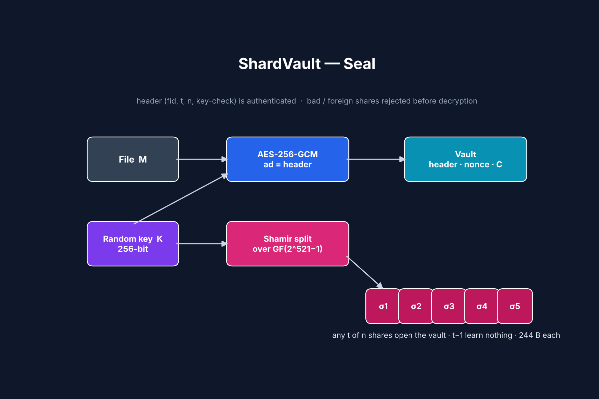

# ShardVault

**Header-bound computational secret sharing for threshold file protection.**

Encrypt a file once; split its key into *t*-of-*n* shares. Any *t* holders can open the file, any *t−1* learn nothing but its length, and tampered or mismatched shares are rejected before decryption.



## How it works

1. A fresh 256-bit key `K` encrypts the file with **AES-256-GCM**. The public header (file ID, `t`, `n`, key-check) is authenticated as associated data.
2. `K` is split with **Shamir's scheme** over GF(2^521 − 1).
3. Each holder gets one 244-byte share, regardless of file size.

Hardening over textbook computational secret sharing (Krawczyk, 1993):

| Threat | Mitigation |
|---|---|
| Threshold or header edited | Header is GCM associated data |
| Corrupted or cheating share | Domain-separated key-check rejects it before decryption |
| Shares from another file mixed in | Per-file share namespace |
| Ciphertext tampering | 128-bit GCM tag |

Security reduces entirely to AES-GCM and Shamir sharing. Full proofs and an attack-surface analysis are in the [paper](shardvault.pdf).

## Quick start

```bash
pip install -r requirements.txt

python3 shardvault.py seal secret.pdf -t 3 -n 5     # writes secret.pdf.svault + 5 share files
python3 shardvault.py open secret.pdf.svault secret.pdf.share1 secret.pdf.share3 secret.pdf.share5 -o recovered.pdf

pytest -q                                          # 7 tests
```

## Performance

Median of 5 runs, (t, n) = (3, 5):

| File | Seal | Open | Overhead |
|---|---|---|---|
| 1 KiB | 0.06 ms | 0.04 ms | 143 B |
| 1 MiB | 0.34 ms | 0.45 ms | 143 B |
| 16 MiB | 5.87 ms | 8.38 ms | 143 B |

## Limitations

- No protection against a malicious dealer (no verifiable secret sharing yet).
- Detects but does not identify a cheating holder.
- Reference implementation uses Python big integers, which are not constant-time.

## Paper

B. Abi-Farah, *ShardVault: Header-Bound Computational Secret Sharing for Threshold File Protection*, 2026. [PDF](shardvault.pdf) · [LaTeX](shardvault.tex)

## License

MIT
